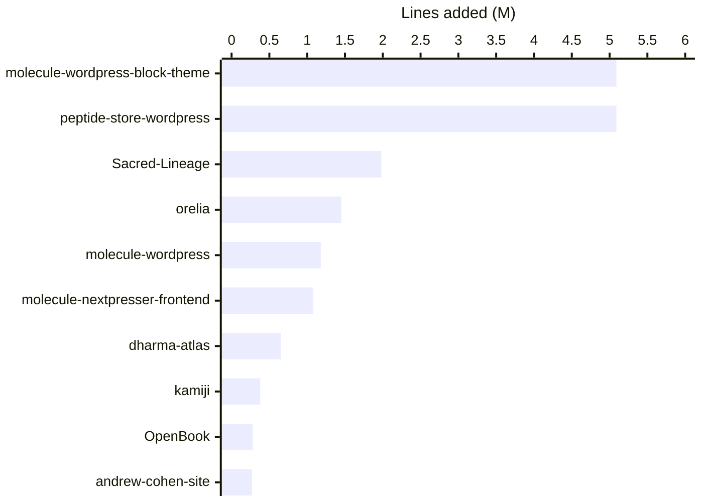
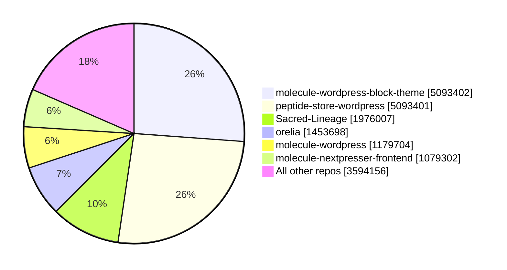
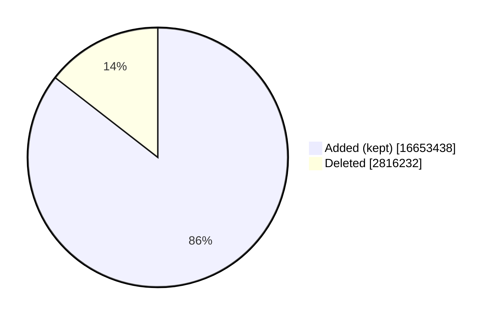

# Lines authored on GitHub (FraterCCCLXIII)

| Metric | Value |
|---|---:|
| Repos with commits found | 90 of 154 owned non-forks |
| Commits | 1617 |
| Lines added | 19469670 |
| Lines deleted | 2816232 |
| **Net lines** | **16653438** |

## Top 10 repos by lines added (millions)

## Share of all lines added

## Added vs deleted

> Raw GitHub line counts: includes generated/data files (JSON catalogs, WordPress theme assets). 64 repos returned no stats or zero lines by you (empty, too large, or commits not linked to your account). The top two repos look like near-copies of each other (about 5.09M each), which inflates the total. Forks excluded.
